# modl: support and moderation, self-hosted

Punishments, reports, tickets, appeals, alt detection, replays, and AI chat review, managed from a web panel that runs inside your own server.

modl is a complete moderation and support system for Minecraft servers. It is free, open source under AGPL-3.0, and entirely yours: the panel runs inside your server or proxy (or on its own with Docker), stores everything in your own database, and needs no account or outside service. Your players and staff only ever see your server's name, logo, and domain.

It runs on **Paper, Folia, Spigot, Velocity, and BungeeCord**, from 1.8.8 to the latest release, with the same features everywhere.

[Source code](https://github.com/modl-gg/modl) | [Documentation](https://github.com/modl-gg/modl/wiki) | [Downloads](https://github.com/modl-gg/modl/releases) | [Discord](https://modl.gg/discord) | [Locale file](https://github.com/modl-gg/modl/blob/main/minecraft/core/src/main/resources/locale/en_US.yml) | [Config file](https://github.com/modl-gg/modl/blob/main/minecraft/core/src/main/resources/config.yml)

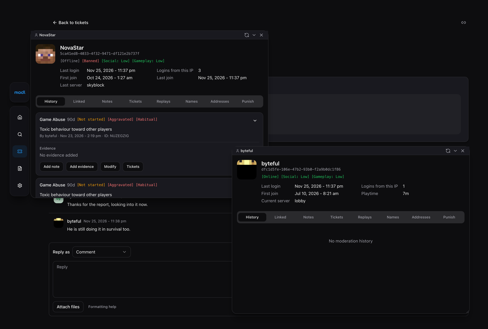

## Getting started

1. Put [PacketEvents](https://modrinth.com/plugin/packetevents) and the modl jar in `plugins/` and start the server.
2. Open the setup address printed in the console and follow the setup wizard.
3. On a network, install modl on the proxy; the proxy's backend servers are listed in the panel with a one-click key for each.

No free port on your host? With your domain on Cloudflare, the built-in Cloudflare Tunnel publishes the panel without opening one.

## Features

### Punishment system

Built to sanction players fairly and consistently while keeping moderator discretion.

- A customizable **point system** that marks players as low, medium, or habitual offenders, separately for gameplay and social offenses
- Customizable durations for every **severity** (lenient, regular, severe) and **offender level**
- Name and skin punishments that **pardon themselves** when the player changes their name or skin
- **Stat-wiping** bans that run a command on your server when they expire (not when pardoned)
- Change durations and pardon (removing the points) without leaving the page
- **Evidence** uploads and links (YouTube, Imgur, and others) on every punishment
- 8-character punishment IDs for appeals, with an appeal form per punishment type
- Bans on offline players start counting down at their next login
- Several bans or mutes run **one after another**, each starting when the previous one ends
- Classic manual punishments too: ban, tempban, mute, tempmute, kick, and blacklist

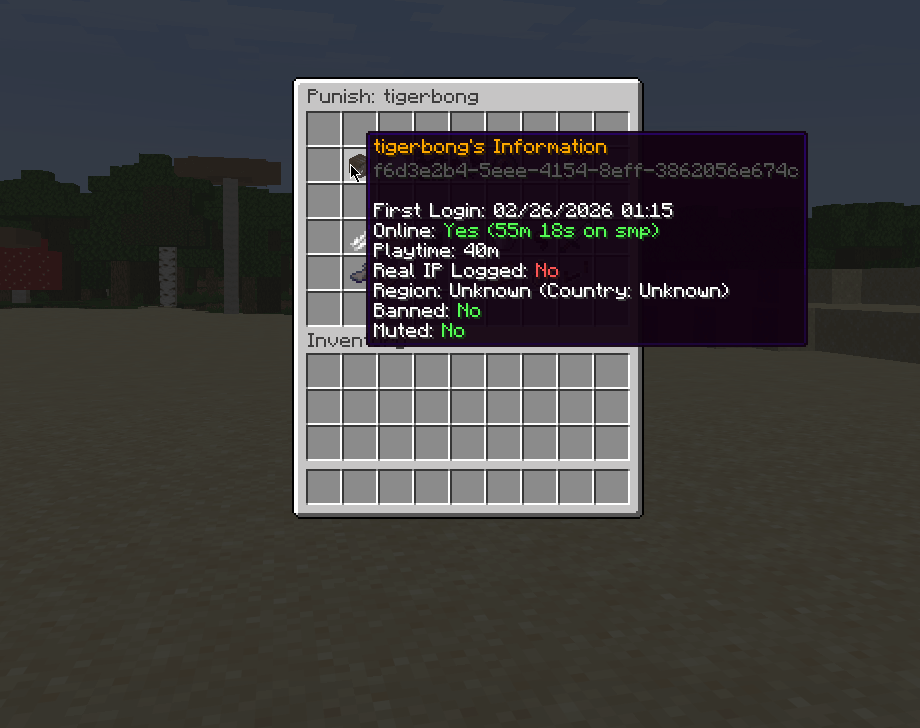

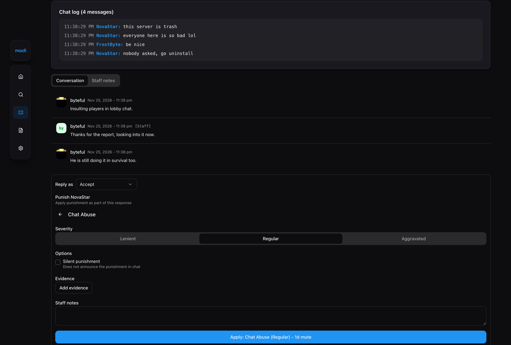

### Reports and tickets

- In-game `/report`, `/chatreport`, and `/hackreport` that attach the **chat log** or a **replay** of the reported player
- Ticket forms for support, staff applications, bug reports, and anything else you define
- Labels, assignees, quick replies, internal staff notes, and Discord webhooks
- A public page where players follow their ticket or appeal, with email updates when mail is set up

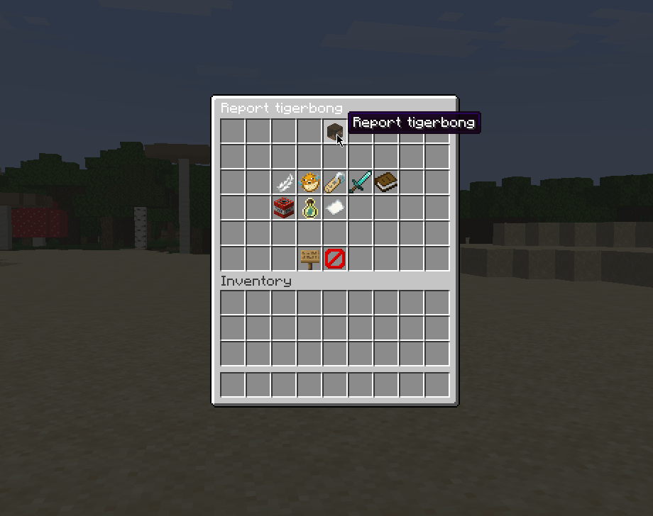

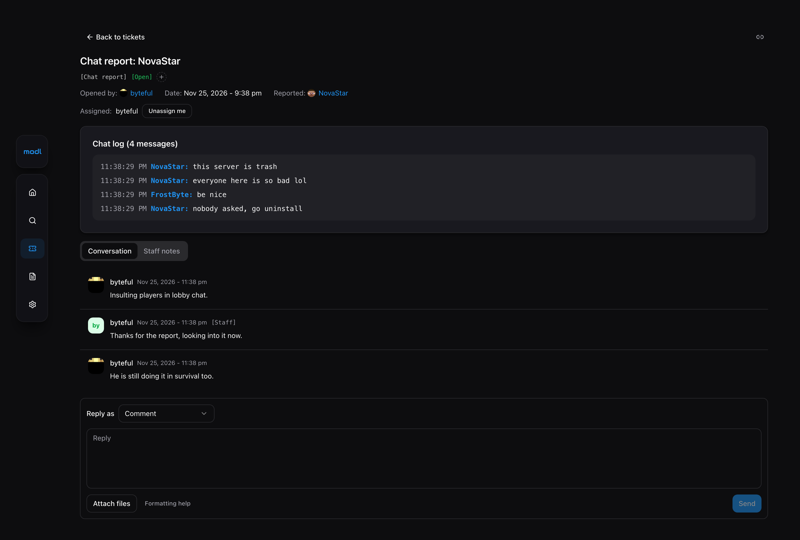

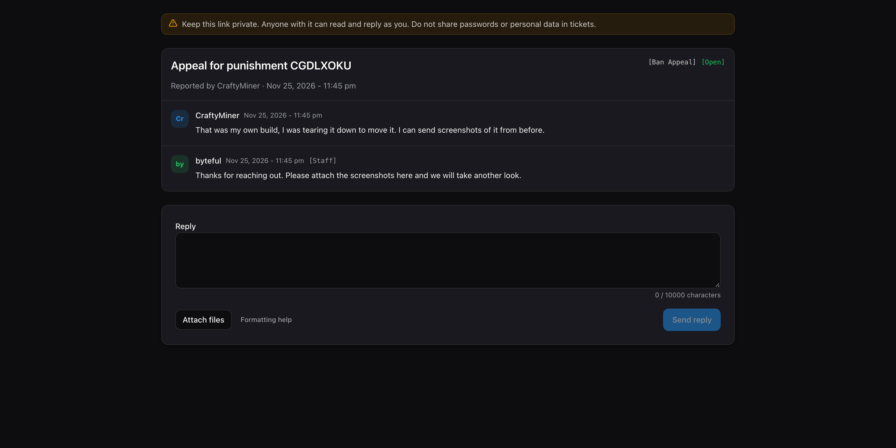

### Replays

- Record a player on request or with a report, then watch it in a **3D viewer in the browser**
- Punish straight from the replay

### AI moderation

- Chat reports reviewed by the AI provider you choose (OpenAI, Anthropic, Google Gemini, or any OpenAI-compatible endpoint), with your own key
- Automatic action only within the limits you set, with hourly and daily budgets

### Alt detection

- Accounts linked through shared addresses, with optional VPN and proxy lookups from the provider you pick
- Alt-blocking bans that follow a player to their linked accounts

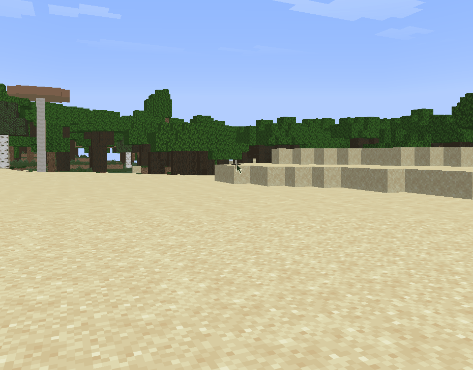

### Staff tools in game

- Staff mode with vanish, freeze, target, and inspection menus, working across a whole network
- Staff chat, slow mode, chat and command logs, and network-wide chat interception
- Punish, inspect, history, notes, and alts menus, plus `/standing` for players

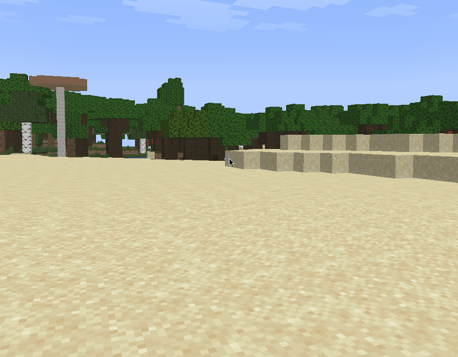

### The panel

- Dashboard, player profiles with full history, audit log, and analytics
- Roles with fine-grained permissions, staff invitations, two-factor authentication, and passkeys
- Sign in with an emailed code, a password, a passkey, or a one-time link from in game
- A public homepage and knowledgebase with your theme, fonts and custom CSS
- Available in 11 languages

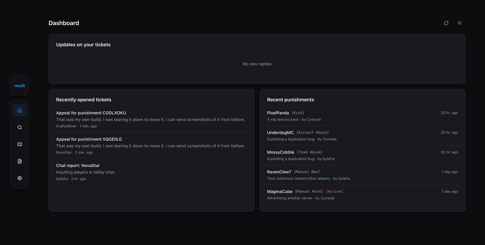

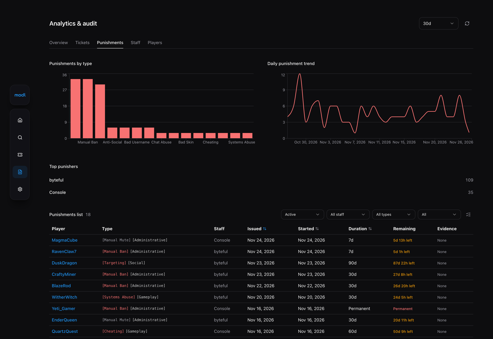

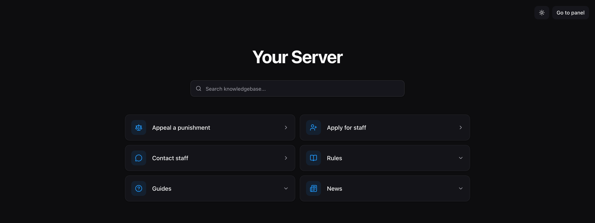

### Built for self-hosting

- One jar: the panel starts inside your server or proxy, with a setup wizard
- SQLite out of the box, or MySQL, MariaDB, or PostgreSQL, movable from the panel
- Local file storage or any S3-compatible bucket
- Nightly backups, signed releases, and one-click updates with automatic rollback
- Import your history from **LiteBans, AdvancedBan, LibertyBans, BanManager, BanSystem**, or the vanilla ban lists

## Requirements

- Java 21 and 2 GB of memory on the server or proxy that runs the panel (servers behind a proxy run on any Java their Minecraft version needs)
- [PacketEvents](https://modrinth.com/plugin/packetevents) on every Paper, Folia, and Spigot server
